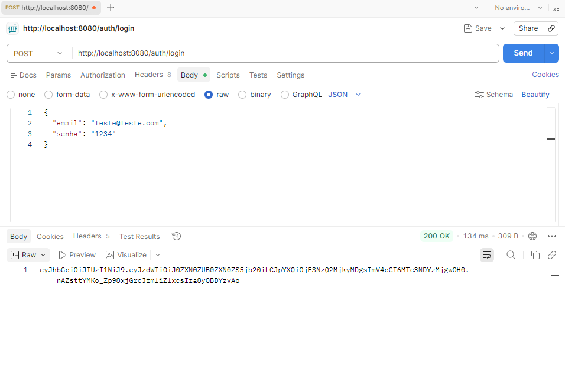

# 🚀 DevTasks API

API REST desenvolvida com **Java 21 e Spring Boot** para gerenciamento de tarefas, com cadastro de usuários, senhas protegidas com BCrypt e geração de **JWT (JSON Web Token)** no login.

Projeto criado com foco em práticas de desenvolvimento backend: endpoints REST, persistência com Spring Data JPA, testes automatizados, containerização e integração contínua.

---

## 📌 Funcionalidades

- ✅ Cadastro de usuários (senha armazenada com hash BCrypt)
- ✅ Login com geração de token JWT (expira em 1 hora)
- ✅ CRUD de tarefas
- ✅ Persistência em banco relacional (MySQL)
- ✅ Testes automatizados (unitários, de controller e de integração)
- ✅ Docker e Docker Compose
- ✅ CI com GitHub Actions

---

## 🛠️ Tecnologias e Ferramentas

- Java 21
- Spring Boot (Spring MVC)
- Spring Data JPA / Hibernate
- MySQL
- JWT (jjwt)
- BCrypt (`spring-security-crypto`)
- Lombok
- Maven
- JUnit 5, Mockito e Spring Test (MockMvc)
- H2 (banco em memória, apenas nos testes)
- Docker e Docker Compose
- GitHub Actions
- Postman

---

## 📂 Endpoints

| Método | Rota             | Descrição                          |
|--------|------------------|------------------------------------|
| POST   | `/usuarios`      | Cadastra um novo usuário           |
| GET    | `/usuarios`      | Lista os usuários (sem a senha)    |
| POST   | `/auth/login`    | Autentica e retorna o token JWT    |
| POST   | `/tarefas`       | Cria uma tarefa                    |
| GET    | `/tarefas`       | Lista as tarefas                   |
| GET    | `/tarefas/{id}`  | Busca uma tarefa pelo id           |
| DELETE | `/tarefas/{id}`  | Remove uma tarefa                  |

### Exemplo de login

```
POST /auth/login
```

```json
{
  "email": "teste@teste.com",
  "senha": "1234"
}
```

A resposta (200 OK) é o token JWT em texto. Credenciais inválidas retornam 401.

---

## 📸 Testes no Postman



---

## 📂 Estrutura do Projeto

```
controller   → Endpoints REST
dto          → Entrada e saída de dados
model        → Entidades JPA
repository   → Acesso ao banco de dados
service      → Regras de negócio
security     → Geração do JWT
config       → Configurações (BCrypt)
```

---

## ⚙️ Como executar

### Opção 1: Docker Compose (recomendado)

Requer Docker. Sobe a API e o MySQL juntos.

```
git clone https://github.com/ViniZiano/Devtasks.git
cd Devtasks
cp .env.example .env     # edite o .env e troque as senhas e o JWT_SECRET
docker compose up --build
```

A API fica em `http://localhost:8080`.

### Opção 2: direto com Maven

Requer Java 21 e um MySQL em execução. Defina as variáveis de ambiente:

| Variável      | Descrição                                   | Padrão                                  |
|---------------|---------------------------------------------|-----------------------------------------|
| `DB_URL`      | URL JDBC do banco                           | `jdbc:mysql://localhost:3306/devtasks`  |
| `DB_USER`     | Usuário do banco                            | `root`                                  |
| `DB_PASSWORD` | Senha do banco                              | vazio                                   |
| `JWT_SECRET`  | Segredo do JWT, mínimo de 32 caracteres     | obrigatório                             |

```
./mvnw spring-boot:run
```

---

## 🧪 Testes

```
./mvnw test
```

A suíte tem 36 testes com JUnit 5 e Mockito:

- **Unitários:** `TarefaService` (repositório simulado com Mockito) e `JwtService`
- **Controller:** `AuthController`, `UsuarioController` e `TarefaController` com MockMvc
- **Integração:** aplicação completa com banco H2 em memória, de ponta a ponta (controller, service, repository e banco)

Não é preciso ter MySQL instalado para rodar os testes. Os endpoints também foram validados manualmente com o Postman.

---

## 🔄 Integração contínua

O workflow em `.github/workflows/ci.yml` roda a cada push e pull request:

1. `test`: executa `./mvnw test` com Java 21
2. `docker`: faz o build da imagem Docker (só roda se os testes passarem)

---

## 🎨 Interface para portfólio

O projeto também conta com uma interface web responsiva em `frontend/`, criada para apresentar o DevTasks de forma visual.

### Como visualizar

1. Entre na pasta `frontend/`.
2. Abra o arquivo `index.html` no navegador.
3. Use **Nova tarefa** para adicionar tarefas e os filtros para alternar entre status.

Por enquanto a interface funciona de forma independente e ainda não está integrada à API.

---

## 🗺️ Roadmap

- [x] Testes automatizados (JUnit 5 + Mockito)
- [x] Containerização com Docker e docker-compose
- [x] CI com GitHub Actions
- [ ] Proteger os endpoints de tarefas com Spring Security e validação do JWT
- [ ] Tarefas vinculadas ao usuário autenticado
- [ ] Validação de entrada e tratamento global de exceções
- [ ] Documentação interativa com Swagger/OpenAPI
- [ ] Versionamento do banco com Flyway
- [ ] Integração real do frontend com a API
- [ ] Deploy (Render/Railway) com link público

---

## 👨‍💻 Autor

**Vinícius Figueiredo Ziano**
Estudante de Análise e Desenvolvimento de Sistemas (ADS), UNIBRA

🔗 LinkedIn: [linkedin.com/in/ViniZiano](https://linkedin.com/in/ViniZiano)
🔗 GitHub: [github.com/ViniZiano](https://github.com/ViniZiano)
