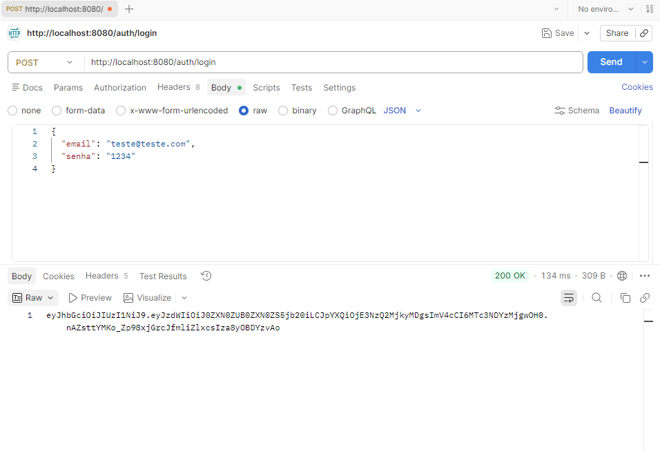

# 🚀 DevTasks

Aplicação web de gerenciamento de tarefas com **API REST em Java 21 + Spring Boot** e um site que consome essa API. Cada usuário cria a conta, faz login e gerencia **apenas as próprias tarefas**, protegidas por **JWT (JSON Web Token)** e Spring Security.

Projeto criado com foco em práticas de back-end: endpoints REST, autenticação e autorização, persistência com Spring Data JPA, testes automatizados, containerização e integração contínua.

> 🔗 **Demonstração:** [viniziano.github.io/Devtasks](https://viniziano.github.io/Devtasks/) (roda só no navegador, sem servidor) · **Versão completa com API:** _em breve (o link entra aqui depois do deploy)_ · 📄 [Guia de deploy passo a passo](DEPLOY.md)

---

## 💡 Problema e solução

**Problema:** listas de tarefas soltas em papel ou em apps genéricos não separam o que é de cada pessoa e não oferecem uma API para integrar com outros sistemas.

**Solução:** uma API REST em que cada usuário só enxerga e altera as próprias tarefas (token JWT em toda requisição), acompanhada de um site simples para criar, editar, concluir e filtrar tarefas.

---

## 📌 Funcionalidades

- ✅ Cadastro de usuários (senha armazenada com hash BCrypt)
- ✅ Login com geração de token JWT (expira em 1 hora)
- ✅ Rotas protegidas com Spring Security: sem token válido a API responde 401
- ✅ CRUD de tarefas **por usuário** (a tarefa de outra pessoa responde 404)
- ✅ Alteração rápida de status (`TODO`, `DOING`, `DONE`)
- ✅ Site em HTML, CSS e JavaScript integrado à API (login, cadastro, filtros, edição e exclusão)
- ✅ Persistência em banco relacional (MySQL)
- ✅ Testes automatizados (unitários, de controller e de integração com segurança)
- ✅ Docker e Docker Compose
- ✅ CI com GitHub Actions

---

## 🛠️ Tecnologias e Ferramentas

- Java 21
- Spring Boot (Spring MVC)
- Spring Security (filtro JWT, rotas protegidas, BCrypt)
- Spring Data JPA / Hibernate
- MySQL
- JWT (jjwt)
- Lombok
- Maven
- JUnit 5, Mockito e Spring Test (MockMvc)
- H2 (banco em memória, apenas nos testes)
- HTML, CSS e JavaScript (sem framework) servidos pelo próprio Spring Boot
- Docker e Docker Compose
- GitHub Actions
- Postman

---

## 📂 Endpoints

| Método | Rota                    | Autenticação | Descrição                                   |
|--------|-------------------------|--------------|---------------------------------------------|
| POST   | `/usuarios`             | pública      | Cadastra um novo usuário                    |
| POST   | `/auth/login`           | pública      | Autentica e retorna o token JWT             |
| GET    | `/usuarios/me`          | token        | Dados de quem está logado (sem a senha)     |
| POST   | `/tarefas`              | token        | Cria uma tarefa para o usuário logado       |
| GET    | `/tarefas`              | token        | Lista as tarefas do usuário logado          |
| GET    | `/tarefas/{id}`         | token        | Busca uma tarefa do usuário logado          |
| PUT    | `/tarefas/{id}`         | token        | Edita título, descrição e status            |
| PATCH  | `/tarefas/{id}/status`  | token        | Altera só o status                          |
| DELETE | `/tarefas/{id}`         | token        | Remove a tarefa (204)                       |

O token vai no cabeçalho `Authorization: Bearer <token>`. Status aceitos: `TODO`, `DOING`, `DONE` (sem status, a tarefa nasce como `TODO`).

### Exemplo de uso com curl

```bash
# 1. cadastrar
curl -X POST http://localhost:8080/usuarios \
  -H "Content-Type: application/json" \
  -d '{"nome":"Vinicius","email":"teste@teste.com","senha":"123456"}'

# 2. login (a resposta é o token em texto)
TOKEN=$(curl -s -X POST http://localhost:8080/auth/login \
  -H "Content-Type: application/json" \
  -d '{"email":"teste@teste.com","senha":"123456"}')

# 3. criar uma tarefa
curl -X POST http://localhost:8080/tarefas \
  -H "Authorization: Bearer $TOKEN" -H "Content-Type: application/json" \
  -d '{"titulo":"Estudar Spring Security","descricao":"JWT na prática","status":"DOING"}'

# 4. listar
curl http://localhost:8080/tarefas -H "Authorization: Bearer $TOKEN"
```

Credenciais inválidas retornam 401. Sem token (ou com token inválido/expirado), as rotas protegidas também retornam 401.

---

## 🖥️ O site

O front-end fica em `src/main/resources/static/` e é servido pelo próprio Spring Boot. Como o site e a API usam a mesma origem, não há configuração de CORS.

Ao subir a aplicação, abra `http://localhost:8080`:

1. Crie uma conta e entre.
2. Use **Nova tarefa** para criar; clique no círculo para concluir; clique no título para editar ou excluir.
3. Use os filtros para alternar entre _A fazer_, _Em andamento_ e _Concluídas_.

O token JWT fica salvo no `localStorage` do navegador e expira em 1 hora (depois disso o site pede o login de novo).

### Demonstração no GitHub Pages

O GitHub Pages só serve arquivos estáticos e não roda o Spring Boot. Por isso a raiz do repositório tem uma cópia do mesmo site (`index.html`, `css/`, `js/`) que, ao ser aberta em `github.io` ou com `?demo` na URL, usa `js/demo-api.js`: um simulador das rotas da API que guarda tudo no navegador de quem acessa. Nada é enviado a servidor algum, e a versão real (Spring Boot + JWT + MySQL) não usa esse arquivo.

A cópia da raiz precisa ficar idêntica à de `src/main/resources/static/`; o CI falha se as duas divergirem. Para atualizar:

```
cp src/main/resources/static/index.html src/main/resources/static/favicon.svg .
cp -r src/main/resources/static/css src/main/resources/static/js .
```

---

## 📸 Testes no Postman



---

## 📂 Estrutura do Projeto

```
controller   → Endpoints REST
dto          → Entrada e saída de dados
model        → Entidades JPA
repository   → Acesso ao banco de dados
service      → Regras de negócio
security     → JWT (geração/validação), filtro e regras de acesso
config       → Configurações (BCrypt)
resources/static → Site (HTML, CSS e JavaScript)
```

---

## ⚙️ Como executar

### Opção 1: Docker Compose (recomendado)

Requer Docker. Sobe a API, o site e o MySQL juntos.

```
git clone https://github.com/ViniZiano/Devtasks.git
cd Devtasks
cp .env.example .env     # edite o .env e troque as senhas e o JWT_SECRET
docker compose up --build
```

O site e a API ficam em `http://localhost:8080`.

### Opção 2: direto com Maven

Requer Java 21 e um MySQL em execução. Defina as variáveis de ambiente:

| Variável      | Descrição                                   | Padrão                                  |
|---------------|---------------------------------------------|-----------------------------------------|
| `DB_URL`      | URL JDBC do banco                           | `jdbc:mysql://localhost:3306/devtasks`  |
| `DB_USER`     | Usuário do banco                            | `root`                                  |
| `DB_PASSWORD` | Senha do banco                              | vazio                                   |
| `JWT_SECRET`  | Segredo do JWT, mínimo de 32 caracteres     | obrigatório                             |

```
./mvnw spring-boot:run
```

---

## 🧪 Testes

```
./mvnw test
```

A suíte tem 49 testes com JUnit 5 e Mockito:

- **Unitários:** `TarefaService` (repositório simulado com Mockito) e `JwtService` (geração e validação do token)
- **Controller:** `AuthController`, `UsuarioController` e `TarefaController` com MockMvc
- **Integração:** aplicação completa com banco H2 em memória e o filtro de segurança ligado, de ponta a ponta. Cobre 401 sem token, token adulterado e o isolamento entre usuários (um usuário não lê, altera nem apaga tarefa de outro)

Não é preciso ter MySQL instalado para rodar os testes.

---

## 🔄 Integração contínua

O workflow em `.github/workflows/ci.yml` roda a cada push e pull request:

1. `test`: executa `./mvnw test` com Java 21
2. `docker`: faz o build da imagem Docker (só roda se os testes passarem)

---

## 🔐 Segurança: o que está feito e o que falta

Feito:

- Senhas com hash BCrypt (nunca devolvidas pela API)
- Segredo do JWT vindo de variável de ambiente (a aplicação não sobe sem ele)
- Rotas protegidas e isolamento de dados por usuário
- Mensagem genérica no login do site (não revela se o e-mail existe)
- Site monta a lista com `textContent` (o que o usuário digita nunca vira HTML)

Limitações conhecidas (honestas, para evoluir depois):

- O token fica no `localStorage`; em um sistema maior, o mais seguro é cookie `HttpOnly` com refresh token
- Ainda não há limite de tentativas de login
- Ainda não há validação de formato de e-mail/tamanho de senha no back-end

---

## 🗺️ Roadmap

- [x] Testes automatizados (JUnit 5 + Mockito)
- [x] Containerização com Docker e docker-compose
- [x] CI com GitHub Actions
- [x] Proteger os endpoints de tarefas com Spring Security e validação do JWT
- [x] Tarefas vinculadas ao usuário autenticado
- [x] Integração real do frontend com a API
- [ ] Validação de entrada (Bean Validation) e tratamento global de exceções
- [ ] Documentação interativa com Swagger/OpenAPI
- [ ] Versionamento do banco com Flyway
- [ ] Deploy com link público ([guia em DEPLOY.md](DEPLOY.md))

---

## 👨‍💻 Autor

**Vinícius Figueiredo Ziano**
Estudante de Análise e Desenvolvimento de Sistemas (ADS), UNIBRA

🔗 LinkedIn: [linkedin.com/in/ViniZiano](https://linkedin.com/in/ViniZiano)
🔗 GitHub: [github.com/ViniZiano](https://github.com/ViniZiano)
